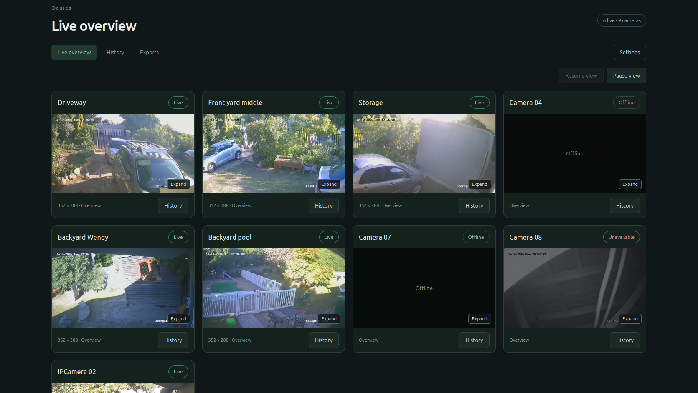
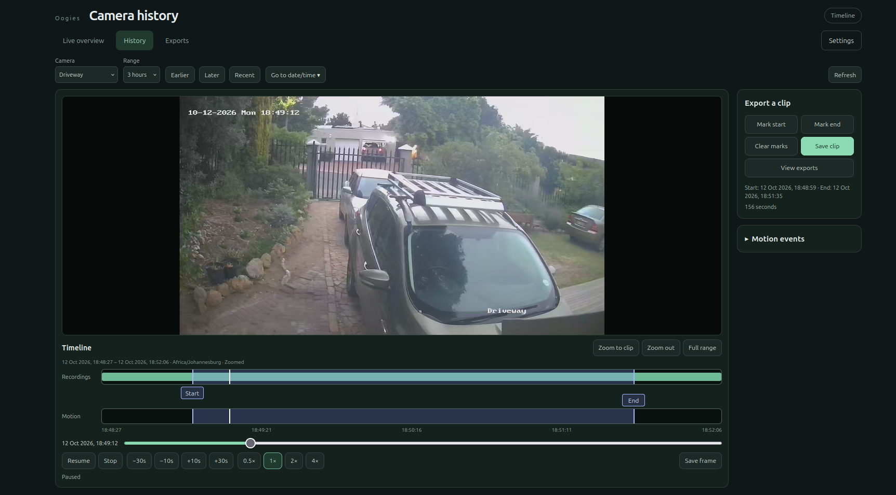
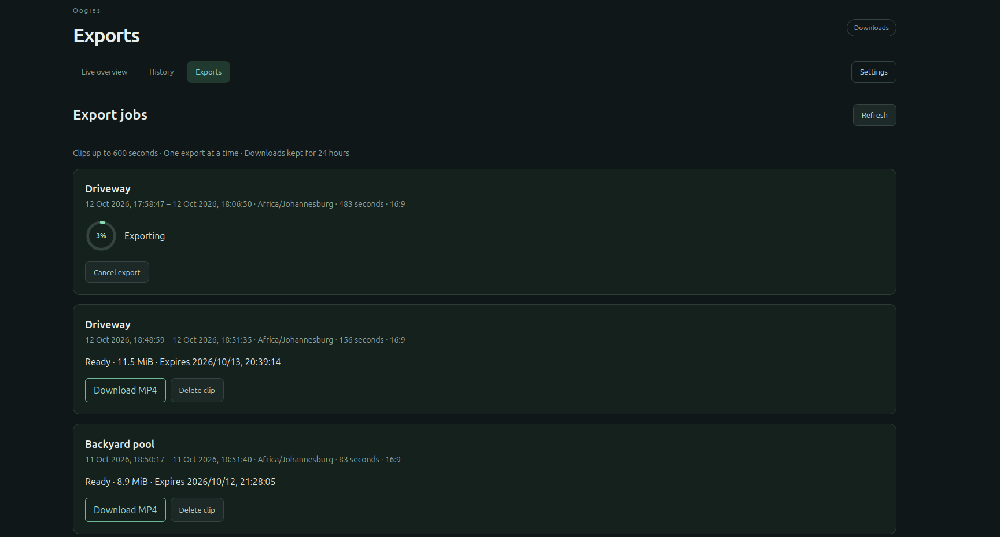

# Oogies

## What is this?

A local only web compattible camera viewer for the HKVision NVR system.

## Why

I din't like the fact that the only way to officially view my camera system on a browser was via a [ActiveX](https://en.wikipedia.org/wiki/ActiveX) control.  Plugin for IE browsers? Yes, yes it is. (Final realase was in 2013).  So I decided to make a new one.

## How

A simple server setup (read [INSTALL](INSTALL.md)) contains the IP and username/password for the NVR on your local network. Then you are good to go.

### How as in how is it put togetehr

The HKVision C++ SDK does most of the heavy lifting of talking to the NVR.  We then have a wrapper around that, that eventually speaks to a Python backend, that serves the JS/HTML front end.

## Pretty pictures

### Live overview

### History

### Clip exports

## Whats up with the name "Oogies"?

It is an Afrikaans word meening eyes.  Sometimes used to refer to looking.
_______________________

The viewer supports a live camera grid, historical playback with motion timelines,
and frame/clip downloads.

- **Setup:** [Install a Docker image](INSTALL.md), [source setup](GETTING_STARTED.md), or the detailed [agent guide](GETTING_STARTED_AGENTS.md).
- **Work:** [Current status, next steps and completed history](docs/work/README.md).
- **Development:** [Implementation plan](docs/implementation-plan.md), [SDK adapter seam](docs/sdk-adapter-seam.md), and [tests/CI](docs/ui-testing.md).
- **Publishing:** [Privacy and publication checks](docs/publication-checks.md).
