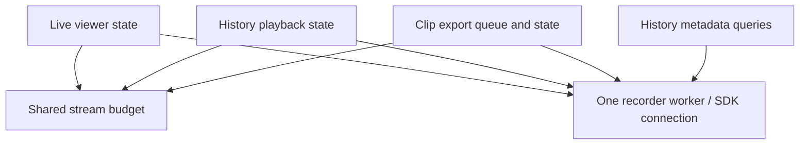

# Target 2: separate export/playback ownership from shared stream capacity

Status: **approved for implementation on 17 October 2026**.
Prepared: 17 October 2026 (Africa/Johannesburg).
Baseline: `0f3bf9f`, the committed target-1 export-accounting fix.
Parent: [architecture refactoring targets](refactoring-targets.md).

## Outcome and interpretation

Clip exports and interactive History playback should own independent state and
lifetimes. Both should obtain recorder capacity through a small neutral budget
component, with no reference to a live-viewing service or each other's mutable
state. An export continues after the user changes cameras, seeks, closes History
or closes the browser. Cancelling that export releases its own reservation and
does not stop another playback or live view.

The existing `ExportJobs` and `PlaybackSessions` classes already own different
state. Task 2 addresses their shared capacity dependency and feature-to-feature
imports. It also moves playback expiry out of `LiveSessions`. Frontend playback
state/rendering separation remains target 4. User-facing workflows, routes and
media formats are preserved in this backend extraction.

## Evidence: what is coupled today

- `PlaybackSessions(worker, live, ...)` inspects `live.used_sources()` and
  `live.limit`, increments/decrements `live.reserved_sources`, and calls
  `live._reconcile()` when a playback is deleted.
- `ExportJobs(worker, live, ...)` performs the same capacity checks and mutations
  around capture, and calls `live._reconcile()` after completion/cleanup.
- `LiveSessions.run_reaper()` reaches into playback through a back-reference
  assigned in `create_server()`. Thus playback expiry depends on the live service.
- Playback, export jobs, export encoding and the worker import time conversion
  helpers from `history_timeline.py`. Several services import the common HTTP
  error type from `live_sessions.py`.
- Tests and diagnostics also inspect or write these internals. Migrating only
  the production constructors would leave the old architecture embedded in the
  test fixtures.

Seven online overviews plus two distinct main streams require nine slots; one
History playback or active export brings this to ten. The owner's private
configuration currently allows ten total/two main streams. Portable defaults
are eight total/two mains. This refactor changes neither setting nor establishes
the recorder's hardware maximum.

## Ownership after the extraction

| Component | Owns | Does not own |
| --- | --- | --- |
| `LiveSessions` | Viewer leases/selections, sharing, quality intent/fallback, desired live sources | Playback/export reservations or playback expiry |
| `PlaybackSessions` | Interactive positions, range, rate, generation, pause/resume and lease expiry; one reservation handle per session | Export jobs, manifests or live selection policy |
| `ExportJobs` | Durable queue, job states, idempotency, storage policy, cancellation and downloads; one handle during active work | Browser leases, History position or another service's counters |
| `HistoryTimeline` | Metadata queries/cache and motion/recording intervals | Video-stream reservations; metadata searches do not consume a viewing slot today |
| `StreamBudget` (new) | Total/HQ limits, identified playback/export reservations, consistent capacity snapshots and admission reasons | SDK calls, queues, playback controls, job states or persistence |
| `GridWorker` | Native commands/events, actual source states/generations and frame caches | Application export queue or admission policy |
| Composition/maintenance wiring | Connect these services and run their maintenance | New user-facing policy or an additional SDK connection |

Exports may share recorder time-conversion code with playback. Sharing pure
utilities does not mean sharing the current selected time, range, marks or
playback session. Export requests remain immutable once queued, as today.



## Proposed small budget boundary

Introduce `stream_budget.py` beside the current backend modules. Suggested
operations below describe the intended contract; final naming can follow the
existing code style.

| Operation | Purpose |
| --- | --- |
| Construct with `condition`, total limit and HQ limit | Reuse the existing worker condition/RLock; have one configured source of truth for the capacity limits. |
| Bind one read-only live-occupancy provider during composition | Observe the distinct desired/live-closing source keys and qualities, without importing `LiveSessions` or duplicating the native lifecycle. |
| `snapshot()` | Return an immutable/copy snapshot: overview, high, playback/export reservations, total used/available and limits. |
| `check_live(quality)` | Return availability or the current `source_limit`/`high_quality_limit` refusal reason before adding a new distinct live source. |
| `try_reserve(kind, owner_id)` | Atomically obtain an opaque handle for `playback` or `export`, or return no capacity. Repeated acquisition by the same active owner returns its existing handle. |
| `release(handle)` | Release that identified reservation once. Duplicate, stale or foreign handles cannot decrement usage or free a different owner's slot. Return whether a reservation was actually removed. |

Use a small in-memory handle map, not an anonymous mutable integer. Handles are
process-local ownership records, not new browser leases, persisted job fields
or native SDK handles. A queued/restored export acquires only when its runner
starts work. Completed downloads reserve no recorder slot.

The live-occupancy provider is a pure in-memory snapshot of the existing
`wanted` plus generation-validated native `stopping` sources. This preserves the
current delayed-stop accounting without adding a second ledger for every native
start/stop. `LiveSessions` remains responsible for selections and starts/stops;
the worker remains responsible for rejecting stale events. Bind the provider
before admission is enabled, especially before a restored export queue starts.
Use no generic provider registry or second-SDK abstraction here.

All snapshot/admission/ownership changes use the same existing condition lock.
For live additions, the availability check and publishing the source into the
desired/occupied state must remain in one locked operation; another playback or
export must not slip into the gap. Reserving a playback/export slot is atomic
inside the budget. This work does not move file I/O out of the shared lock;
that remains target 5.

## Preserve notification and maintenance behavior

Removing private `_reconcile()` calls must not leave spare capacity unused until
another browser request. Preserve the current immediate reconciliation of
waiting overview sources when a playback/export reservation is released.

The simplest proposed wiring is one optional capacity-released callback on the
budget, installed by composition and targeting a small public live-capacity
refresh method. The budget knows only the callable, not a feature service. It
invokes the callback after removing an actual reservation, under the same
reentrant condition lock, then wakes capacity waiters. Repeated release is a
no-op and must not trigger another reconciliation. Test callback reentry into
budget snapshots and ensure refresh does not release reservations recursively.
This is a single application hook, not an event bus or subscriber framework.
If refresh raises, the reservation must still be released and capacity waiters
notified in cleanup; do not roll back the release or silently hide the failure.

This keeps the existing order: reconcile desired overview capacity before
waking queued exports. Existing admitted work is retained; there is no new global
priority/fairness queue. Refused HQ requests still require explicit retry.

Move the periodic live-maintenance/playback-expiry calls into a small function
owned by server composition, with an explicit stop event. Keep the existing
roughly one-second maintenance cadence and one thread. Both real startup and
offline fixtures use it. Remove `live.playback_sessions`; closing live viewers
must not stop the application's playback maintenance while History remains in
use. Do not expand this into a general application-lifecycle rewrite (target 8).

## Reservation lifetimes to preserve

| Owner/state | Budget behavior |
| --- | --- |
| Live overview/main source | One slot per distinct source, shared across viewers. A main consumes its HQ slot and an extra total slot while overview fallback is retained. |
| Live stop requested | Remains occupied until the current-generation native stop is acknowledged. A stale acknowledgement frees nothing. |
| Playback starting/seeking/playing/paused/ended/error | One reservation for that interactive session until explicit delete, expiry or shutdown, matching the current policy. Seek/rate/range changes reuse it. |
| Playback start exception | Roll back the new session and its reservation exactly once. |
| Export queued or waiting for storage/capacity | No reservation. Keep existing queue bounds, FIFO order and wait reasons. |
| Export starting/capturing/finalizing | Runner owns one reservation through capture/encoder cleanup. Browser navigation has no effect. |
| Export cancellation/failure/success/shutdown | Runner cleanup releases its handle exactly once, including failures between acquisition and starting the encoder. The DELETE handler requests cancellation; it does not independently release an active capture's handle. |
| Ready/failed/cancelled/expired export or file download | No recorder reservation after active cleanup; preserve file-reader retention separately. |

Release must occur in cleanup even if state persistence or file cleanup raises.
Do not add retries of recorder authentication. Retain current playback/export
release points relative to native stop commands: their protocol does not expose
the live stream's stop-acknowledgement contract. Extending that protocol would
be separate work rather than an unverified guarantee in this extraction.

## Remove incidental feature imports

Move `SessionError` into a small neutral `service_errors.py` with the same class
name/status behavior. Move `timestamp`, `utc_text`, `recorder_wall` and
`recorder_utc` into `recorder_time.py`, preserving signatures, validation,
whole-second semantics and daylight-saving rejection exactly.

Update the current callers in history metadata, playback, exports, encoder,
worker, server, diagnostics and tests. These are moves of shared functions;
do not introduce a new date/time model or change timezone behavior. Any
temporary import aliases during migration should be removed by completion.

## Tests to add or strengthen before completing the refactor

Use named cases in a new `tests/test_stream_budget.py` for the isolated budget,
then existing service suites for ownership/integration. Names are proposed.

| Test | Required setup and assertions |
| --- | --- |
| `test_snapshot_counts_distinct_live_sources_and_reservations` | Seven fake overview keys, two mains and one playback: used ten, available zero, HQ two. Copy/immutable snapshots cannot mutate the budget. No worker/SDK needed. |
| `test_live_capacity_distinguishes_total_and_high_limits` | Independently exhaust each limit, including HQ disabled; verify existing refusal codes and total/HQ counts. |
| `test_reservation_is_idempotent_for_same_owner` | Reserve twice for one owner; return the same live handle and occupy one slot. Different kinds/owner IDs remain independent. |
| `test_duplicate_stale_or_foreign_release_cannot_free_another_slot` | Repeated release, a handle from another budget and an old handle after reacquisition leave other owners and the new reservation intact; usage never becomes negative. |
| `test_competing_reservations_cannot_exceed_last_slot` | Barrier-coordinate playback/export contenders with one slot free; exactly one wins. A rejected contender issues no native start. Repeat the scenario for live versus a non-live reservation at the service boundary. |
| `test_closing_live_source_counts_until_current_stop_ack` | Delay native stop acknowledgement; neither total nor HQ space is prematurely available. Inject an old generation event, then the valid one. Verify capacity and explicit retry behavior. |
| `test_release_refreshes_overview_once_and_notifies_waiters` | Release a real reservation; public live refresh runs once before waiters proceed, recovers a previously capacity-limited overview, and safely reads budget state under the shared lock. Duplicate release has no effect. |
| `test_release_keeps_accounting_correct_if_refresh_raises` | Inject a refresh failure after removing a reservation. The error remains visible, ownership stays released, waiters are notified and a duplicate release does not free another slot. |
| `test_playback_start_failure_rolls_back_its_handle` | Force the worker start method to fail. No leaked session/reservation, no second login and no mutation of another owner's slot. |
| `test_seek_rate_range_and_pause_reuse_playback_reservation` | Exercise controls and generations. Keep one handle throughout, preserve independent positions, release only on delete/expiry/shutdown. |
| `test_export_failure_after_acquire_releases_once` | Parameterize failure during queued-to-running persistence, capture startup, encoding and cleanup. The acquired export handle is always released; existing error behavior remains visible. |
| `test_waiting_export_holds_no_slot_and_preserves_fifo` | Exhaust capacity/storage, enqueue jobs, cancel one waiter and release capacity. No waiting handle/native retry; surviving jobs start in current FIFO order. |
| `test_playback_and_export_cancellation_are_independent` | Start both; stop/expire playback while export continues, then cancel an export while a separate playback continues. Assert only the intended handles/commands change. |
| `test_export_request_survives_history_seek_camera_change_and_close` | Queue with immutable times/camera, navigate/seek/close History or its browser, and verify capture request, progress and completion remain intact. Extend the existing offline UI flow rather than duplicating it wholesale. |
| `test_maintenance_expires_playback_without_live_viewers` | Controlled lease clock and maintenance tick with no live leases. Playback expires and releases its own handle while an active export remains. Stop/join maintenance deterministically. |
| `test_status_preserves_existing_capacity_fields` | Real loopback HTTP status includes unchanged fields/count meanings (`reserved_sources` = playback + export, occupied = live + reservations), including live sources closing. |
| `test_shared_time_helpers_preserve_validation` | Retain existing range/timezone/ambiguous-time tests and verify imports and exception type after extraction. |

Use barriers/events, fake clocks and explicit maintenance ticks instead of
arbitrary sleeps to create races. Assert each injection actually occurred.
Budget unit tests use a small synthetic live-occupancy provider, not the SDK or
an entire HTTP server. Service tests use real budget/session code and replace
only native transport. Fakes must not reimplement capacity policy.

Preserve all seven target-1 accounting cases. Replace tests that mutate
`reserved_sources` with owned reservations, and replace the accounting test's
live-counter tracking subclass with acquisition/release observations at the new
budget boundary. Fixtures choose limits explicitly; avoid compatibility setters
that let other features mutate the new budget's internals.

## Implementation stages after plan review

1. **Characterize existing ownership.** Add/extend control, cancellation,
   maintenance and status tests against the existing implementation where
   possible. Record the delayed-live-stop and explicit-HQ-retry invariants.
2. **Extract neutral utilities and isolated budget.** Move shared error/time
   functions and add the budget tests. Bind synthetic occupancy without a worker
   for unit tests. Constructor/fixture wiring is explicit; snapshot/admission is
   disabled until the live provider is bound.
3. **Connect live admission and non-live owners.** Supply the same budget to
   `LiveSessions`, `PlaybackSessions` and `ExportJobs`; replace anonymous counter
   mutations with stored handles and cleanup. Wire the one release callback.
   Bind occupancy/callback before constructing `ExportJobs`, whose constructor
   may immediately run restored queued work.
4. **Decouple maintenance and migrate callers.** Move periodic reaping to
   composition, update server/fixture/diagnostic construction, and remove the
   old cross-service references and temporary adapters. Keep public API fields
   and failure reasons stable; status assembly reads the shared snapshot.
5. **Verify and review.** Run budget and existing service/backend suites, then
   the full offline browser/native suite. Record results and remaining limits.
   Review before any bounded recorder smoke check or service restart.

Estimated effort: **2-4 focused developer days including testing**, refined from
the initial 1-3 day budget-only estimate because shared helper imports,
maintenance ownership and test/diagnostic construction also need migration.
These stages are reviewable slices of one extraction, not authorization to
implement other architecture targets.

## Compatibility and scope boundaries

Expected production files: new `stream_budget.py`, neutral error/time modules,
and updates to `live_sessions.py`, `playback_sessions.py`, `export_jobs.py` and
`grid_server.py`. Time-helper callers also include `history_timeline.py`,
`grid_worker.py` and `export_encoder.py`. Tests/fixtures and the existing
diagnostic construction/import sites migrate alongside these files. No frontend
production change is expected; frontend tests validate preserved behavior.

- Existing frontend controls and routes, clip marks, export manifest/download
  format, immutable requests and persistence/restart semantics remain in place.
- Keep one worker/login and the current SDK adapter. No new framework, broker,
  database, authentication flow or runtime capacity-tuning API is proposed.
- Keep application source limits and existing HQ fallback/retry policy. The
  budget is not a guarantee of device hardware limits or a scheduling optimizer.
- Store neither reservation handles nor recorder credentials in frontend state.
  Queued jobs survive restart; interrupted active captures fail as today, and
  capacity starts from a fresh in-memory ledger in the new worker process.
- Keep file accounting best-effort and its target-1 regression tests intact.
  Disk quotas and stream reservations are separate resources.
- Refused live HQ requests are not queued; exports retain their existing queue.
  No new preemption, background retries or cross-feature fairness promises.
- Native transport, JPEG pipeline, lock-scope/performance redesign and frontend
  state/render separation remain later targets.

## Verification commands and completion criteria

After implementation, use the normal native backend tests (with inherited
`LD_LIBRARY_PATH`/`LD_PRELOAD` cleared if required by this host):

```sh
python3 -m unittest discover -s tests -p test_stream_budget.py -v
python3 -m unittest discover -s tests -v
python3 tools/run_ui_tests.py
git diff --check
python3 tools/check_publication.py --history
```

The browser/native suite runs in the existing restricted Docker environment and
needs no recorder credentials. Runtime/compiler dependencies stay in Docker.
Run focused browser cases while migrating, including sharing/two-main capacity,
History alongside live viewing, export queue/download/cancel and lease expiry;
complete the full suite once the final wiring settles. Exact case counts will
depend on additions (baseline: 107 backend, 92 browser/native).

Completion requires passing new budget/ownership tests, retained target-1 tests,
the full backend and offline browser/native suites, and documented import and
dependency checks. In particular:

- Playback and export objects have no `live` reference, live counter writes or
  calls to live's private methods, and neither depends on the other's state.
- Common error/time helpers are no longer owned/imported through feature modules.
- Live owns no playback reference; maintenance operates with zero live viewers.
- Capacity counts, delayed-stop behavior, explicit HQ retry and immediate
  overview recovery match the current contract.
- Restored exports cannot acquire slots before live-occupancy wiring is ready.
- No negative, leaked or multiply released reservations in failure/shutdown tests.
- Server status and browser coexistence flows retain their current behavior.

No running-service changes or NVR probes are part of preparing this plan.
